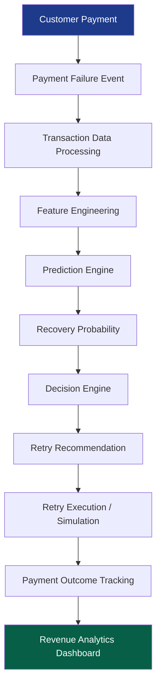

# PayPulse

Intelligent Payment Failure Recovery Engine

---

## Overview

PayPulse is a **FinTech Machine‑Learning platform** that predicts whether a failed payment will eventually recover and recommends the most cost‑effective retry strategy. It consists of three independent components:

1. **Prediction Engine** – ML models that output a recovery probability.
2. **Decision Engine** – Business‑logic layer that converts probabilities into concrete retry actions.
3. **Recovery Tracking Engine** – Persists actual retry attempts and outcomes for analytics.

The system is built with a clean separation between data/ML, backend API, database, and React frontend.

---

## Architecture



*The three core services (Prediction, Decision, Tracking) expose REST endpoints via **FastAPI** and store their state in **PostgreSQL**. The React dashboard consumes these APIs to present analytics, model insights, and configuration screens.*

---

## Folder Structure

```
PayPulse/
├─ .gitignore                     # standard ignore patterns
├─ README.md                      # this file
├─ requirements.txt                # Python dependencies
├─ .env.example                    # template for environment variables
├─ Milestones.md                   # development checklist
├─ data/
│   ├─ raw/                       # synthetic dataset (generated)
│   └─ processed/                 # cleaned / feature‑engineered data
├─ src/
│   ├─ __init__.py
│   ├─ data_generator.py          # synthetic data generator (std lib only)
│   ├─ data_processing.py         # load & basic cleaning utilities
│   └─ ... (future modules)
├─ models/                         # trained model artefacts (Joblib)
├─ notebooks/
│   └─ 01_exploratory_data_analysis.ipynb
├─ api/
│   ├─ main.py                    # FastAPI entry point
│   ├─ schemas.py                 # Pydantic models
│   └─ routes/
│       ├─ __init__.py
│       ├─ transactions.py
│       ├─ predictions.py
│       └─ retries.py
└─ frontend/
    ├─ package.json
    ├─ vite.config.ts
    ├─ tailwind.config.js
    └─ src/
        ├─ App.tsx
        ├─ main.tsx
        ├─ components/…
        └─ pages/…
```

---

## Getting Started (local dev)

1. **Clone the repository** (or copy the folder you see here).
2. **Create a Python virtual environment** and install dependencies:
   ```powershell
   cd PayPulse
   python -m venv .venv
   .venv\Scripts\activate   # or `source .venv/bin/activate` on *nix
   pip install -r requirements.txt
   ```
3. **Generate the synthetic dataset** (already done, but you can re‑run):
   ```powershell
   python src/data_generator.py
   ```
   This creates `data/raw/synthetic_transactions.csv` (≈ 20 k rows).
4. **Run a quick data sanity check**:
   ```python
   import pandas as pd
   df = pd.read_csv(r"data\raw\synthetic_transactions.csv")
   print(df.head())
   print("Recovery rate:", df["recovered"].mean())
   ```
5. **Start the API server** (development mode):
   ```powershell
   uvicorn api.main:app --reload --port 8000
   ```
   Visit `http://localhost:8000/docs` for the auto‑generated Swagger UI.
6. **Frontend** (will be functional in later milestones). You can create a placeholder React app now:
   ```powershell
   cd frontend
   npm install               # requires internet
   npm run dev               # Vite dev server on http://localhost:5173
   ```

---

## Next Steps

- **Milestone 2** – data cleaning & exploratory analysis notebook.
- **Milestone 3** – feature‑engineering pipeline.
- **Milestone 4** – model training, evaluation, and persistence.
- **Milestone 5** – implement the decision engine and revenue calculator.
- **Milestone 6‑15** – backend expansion, full frontend, testing, Dockerisation, documentation.

---

## License

MIT – see `LICENSE` file (to be added).
